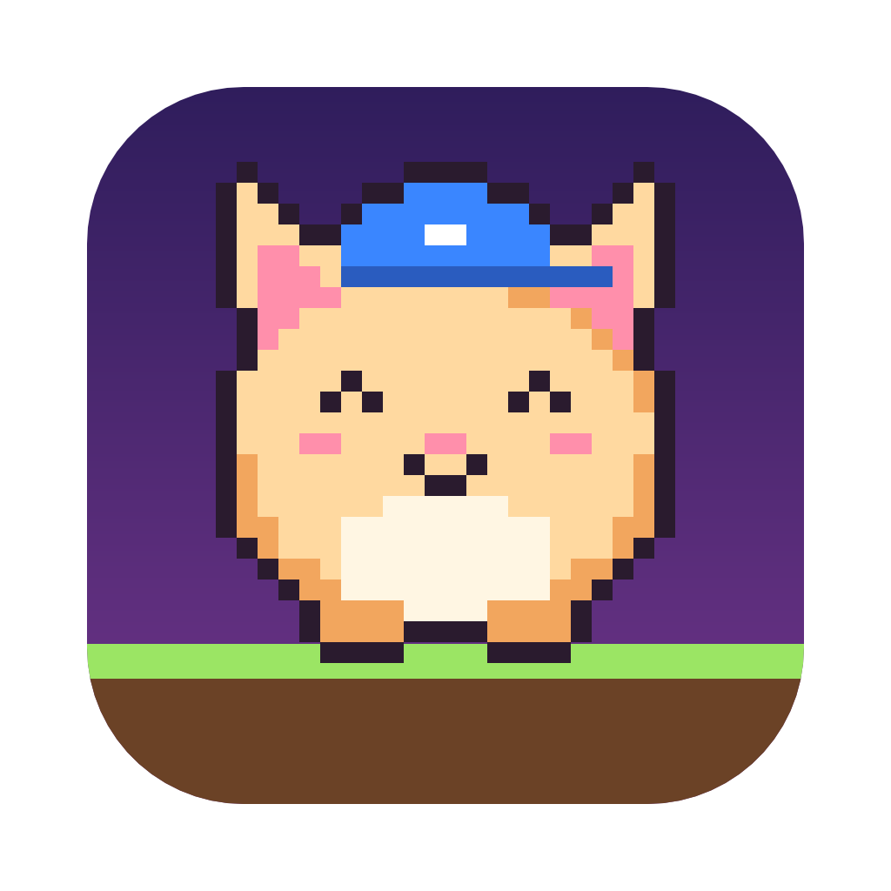
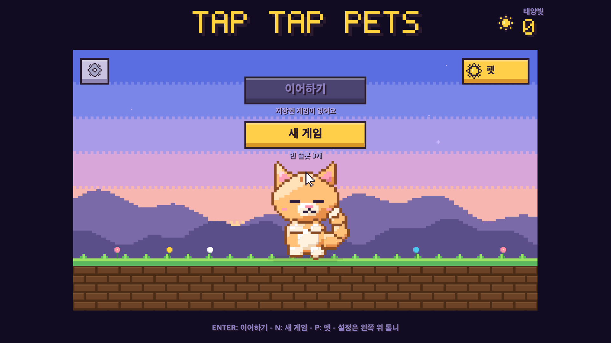
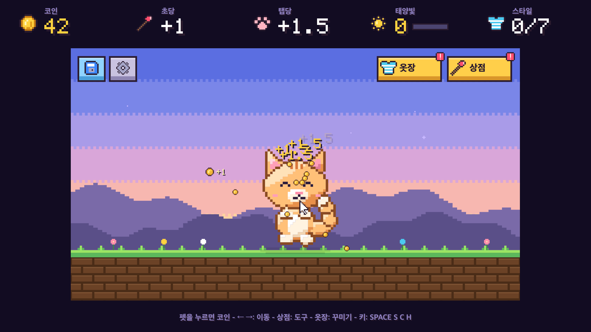
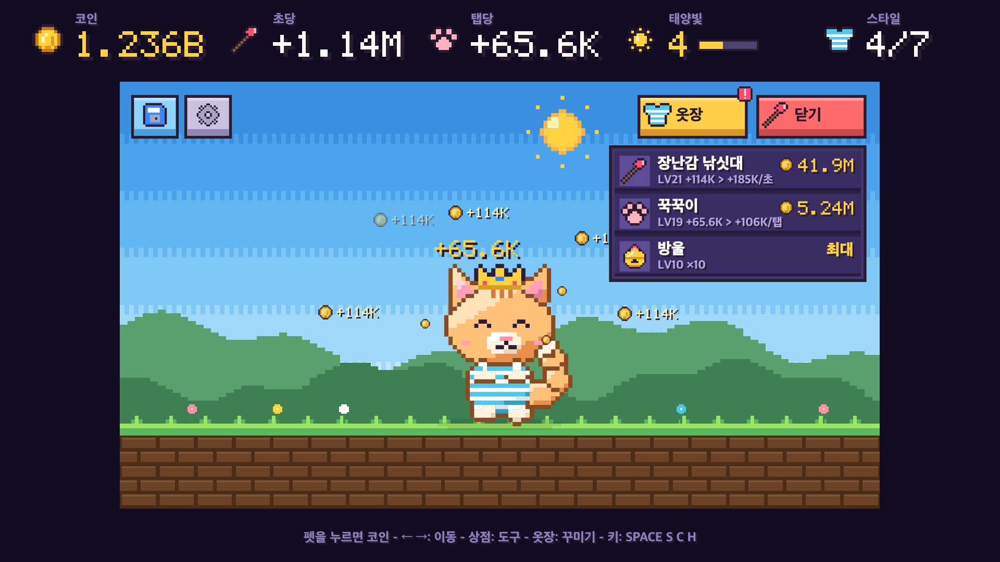

<p align="center">
  
</p>

<h1 align="center">Tap Tap Pets</h1>

<p align="center">
  톡톡 두드려 코인을 모으고,<br>
  햇살로 새 친구를 데려와 귀엽게 꾸미는 픽셀 방치형 펫 게임
</p>

<p align="center">
  <a href="https://github.com/dailyco/tap-tap-pets/releases/latest"><b>Mac용 내려받기</b></a>
  ·
  <a href="https://yutopia.dev/tap-tap-pets">소개 페이지</a>
  ·
  <a href="#english">English</a>
</p>

<p align="center">
  
  
  
</p>

## 내려받기

1. [Releases](https://github.com/dailyco/tap-tap-pets/releases/latest)에서 `Tap.Tap.Pets.zip`을 내려받아요.
2. zip을 열면 나오는 **Tap Tap Pets** 앱을 응용 프로그램 폴더로 옮겨요.
3. 처음 열 때 "확인되지 않은 개발자" 경고가 뜨면, 시스템 설정 → 개인정보 보호 및 보안 아래쪽의 **그래도 열기**를 눌러요. 한 번 열고 나면 다음부터는 바로 열려요.

- Apple Silicon(M1 이후) Mac에서만 실행돼요. 인텔 Mac과 Windows는 아직 지원하지 않아요.
- 무료예요. 개인이 만든 앱이라 Apple 서명이 없어서 처음 한 번만 위 과정을 거쳐야 해요.

## 게임 방법

- 가만히 둬도 1초마다 코인이 쌓이고, 펫을 누르면 코인을 더 받아요.
- **상점**: 펫마다 다른 도구 세 개를 레벨업해요. 초당 코인, 탭 코인(같은 레벨 초당 코인의 2배, 가격은 절반), 그리고 자동 코인이 초당 몇 번 들어올지(최대 10번).
- **옷장**: 모자·옷·액세서리를 입어 보고 마음에 들면 사요.
- **태양빛**: 플레이 화면에 20분 머물 때마다 +1(가만히 둬도 쌓여요). 게임을 꺼 둔 동안은 쌓이지 않아요.
- **펫**: 홈 화면에서 태양빛으로 새 펫을 데려와요. 새 펫은 새 게임으로 시작해요.
- 저장 슬롯은 3개, 슬롯 하나에 펫 하나. 자동 저장, 효과음, 배경음악, 언어(한국어/English)는 설정에서 바꿔요.

| 펫 | 값 | 능력 | 도구 |
| --- | --- | --- | --- |
| 고양이 | 스타터 | 탭 코인 +50% | 장난감 낚싯대 · 꾹꾹이 · 방울 |
| 우파 | 태양빛 3 | 1% 확률로 잭팟 ×5 | 물방울 펌프 · 지느러미 박수 · 물레방아 |
| 뭉게 | 태양빛 5 | 초당 코인 +25% | 구름 방석 · 몽글 박치기 · 바람개비 |
| 모찌룡 | 태양빛 8 | 모든 코인 +25%, 5% 확률로 잭팟 ×5 | 보물 · 날갯짓 · 여의주 |

### 조작

| 화면 | 마우스 | 키 |
| --- | --- | --- |
| 홈 | 버튼 클릭 | `Enter` 이어하기, `N` 새 게임, `P` 펫, 창에서 `1`–`4`로 고르기 |
| 플레이 | 펫 클릭 | `Space` 탭, `←` `→`(`A` `D`) 이동, `S` 상점, `C` 옷장, `H` 저장 |
| 저장 후 | 홈으로 / 계속하기 | `Enter` 홈으로, `Esc` 계속하기 |
| 상점·옷장 | 줄 클릭(옷장은 입어 보기) | 숫자 키로 고르기, 옷장에서 `Enter` 구매 |
| 창·드롭다운 | 바깥 클릭으로 닫기 | `Esc` |

게임은 내 Mac 안(`~/Library/Application Support/pixel-pet-save.db`)에 저장돼요.

## English

**Tap Tap Pets** is a cozy pixel idle pet game for Apple Silicon Macs. Tap your pet to collect coins, level up its
tools, dress it up in the closet, and gather sunlight to bring home new friends. Switch the language to English in
Settings.

[Download for Mac](https://github.com/dailyco/tap-tap-pets/releases/latest) — unzip, move the app to Applications,
and the first time macOS warns about an unidentified developer, choose **Open Anyway** in System Settings → Privacy &
Security.

---

## 개발

raea로 만든 게임이에요. React(TSX)로 화면을 쓰고 raea가 GPU로 그려요. 실행하려면 raea CLI와 [bun](https://bun.sh)이
필요해요. raea는 [docs/raea-patches](docs/raea-patches)의 패치(창이 쓸데없이 다시 그리지 않게 해 발열을 줄여요)를 적용해
빌드한 걸 써요.

```sh
raea play edit.tsx --size 1600x900   # 창을 띄워 바로 플레이
bun test                              # 경제·저장·입력 로직 테스트
raea check edit.tsx --quick           # 화면 검사
```

### 지금 세이브는 두고 새로 시작하기

이름을 붙여 실행하면 `saves/<이름>.db`에 따로 저장돼요. 평소 세이브는 건드리지 않아요.

```sh
sh play.sh            # 평소 세이브
sh play.sh fresh      # "fresh"라는 별도 게임: 처음엔 새로 시작, 다음엔 이어서
sh play.sh fresh2     # 또 다른 새 게임
```

raea가 PATH에 없으면 `RAEA=<raea 경로> sh play.sh fresh`처럼 실행해요. 앱도 같은 환경변수로 따로 저장할 수 있어요.

```sh
TAP_TAP_PETS_SAVE="$PWD/saves/fresh.db" "out/Tap Tap Pets.app/Contents/MacOS/Tap-Tap-Pets"
```

### 맥 앱 만들기

raea 레포에 패치를 적용하고 게임 플레이어를 빌드한 뒤 앱으로 묶어요. 패치 없이 빌드한 앱은 창이 디스플레이
주사율마다(가려지면 초당 1,000번 넘게) 다시 그려서 노트북이 뜨거워져요.

```sh
# raea 레포에서 (패치는 한 번만)
git apply <이 레포>/docs/raea-patches/live-frame-pacing.patch
cargo build --release -p raea-cli
cargo build --profile game -p raea-app-game --bin raea-game --features player

# 이 레포에서
raea export-game edit.tsx -o "out/Tap Tap Pets.app" --target mac-app \
  --name "Tap Tap Pets" --icon media/app/icon.png \
  --player <raea 레포>/target/game/raea-game
ditto -c -k --keepParent "out/Tap Tap Pets.app" "out/Tap Tap Pets.zip"
```

만든 zip은 [Releases](https://github.com/dailyco/tap-tap-pets/releases)에 올려요.

### 파일

| 파일 | 내용 |
| --- | --- |
| `edit.tsx` | 게임의 루트 컴포지션, 저장과 효과음 |
| `game.ts` | 게임 상태와 한 프레임씩 진행하는 순수 함수 |
| `pets.ts`, `items.ts` | 펫 능력·도구 가격, 꾸미기 아이템 |
| `state.ts`, `save.ts` | 저장 데이터 모양과 SQLite 읽기·쓰기 |
| `petShapes.ts`, `petArt.ts`, `art.ts` | 펫·아이콘·픽셀 폰트 그림 |
| `layout.ts`, `ui/` | 화면 배치와 화면별 컴포넌트 |
| `i18n.ts` | 한국어·영어 문구 |
| `media/` | 효과음, 배경음악(`media/bgm`), 앱 아이콘, 배경 그림(`media/bg`) |
| `sfx.mjs`, `bgm.mjs`, `music.ts` | 효과음과 배경음악을 만드는 스크립트(`node bgm.mjs`), 음악 루프 길이 |
| `ui/scenery.ts`, `tools/` | 하늘·언덕·땅 그림 데이터와, 그걸 `media/bg` PNG로 만드는 도구(`bun tools/scenery.ts`) |
| `sheets/` | 디자인 확인용 시트, README 스크린샷(`raea render sheets/readme-shots.tsx --at 0,1,2`) |
| `tests/` | `bun test` 테스트 |
| `docs/superpowers/` | 설계 문서와 구현 계획 |
