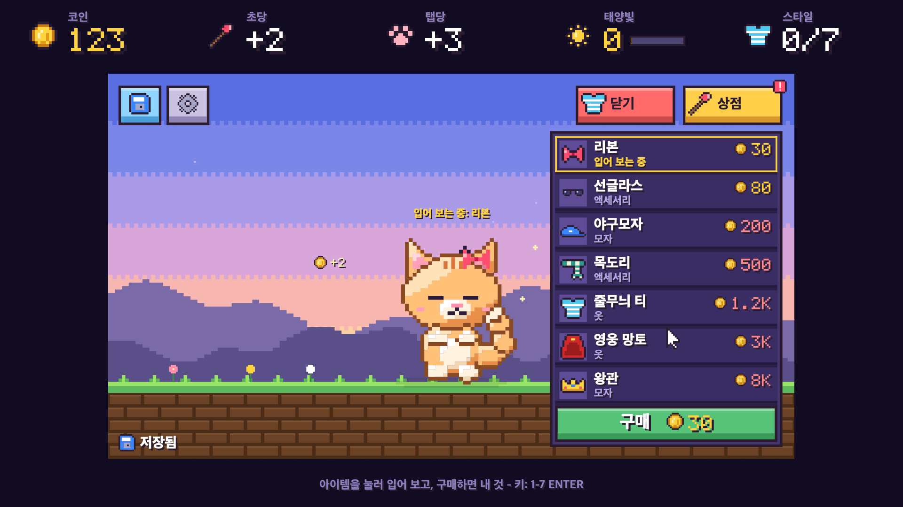

# Tap Tap Pets

톡톡 두드려 코인을 모으고, 햇살로 새 친구를 데려와 귀엽게 꾸미는 픽셀 방치형 펫 게임.

<p>
  
  
  
</p>

raea로 만든 게임입니다. React(TSX)로 화면을 쓰고 raea가 GPU로 그립니다.

## 게임 방법

- 가만히 둬도 1초마다 코인이 쌓이고, 펫을 누르면 코인을 더 받아요.
- **상점**: 펫마다 다른 도구 두 개(초당 코인, 탭 코인)를 레벨업해요.
- **옷장**: 모자·옷·액세서리를 입어 보고 마음에 들면 사요.
- **태양빛**: 플레이 화면에 20분 머물 때마다 +1(가만히 둬도 쌓여요). 게임을 꺼 둔 동안은 쌓이지 않아요.
- **펫**: 홈 화면에서 태양빛으로 새 펫을 데려와요. 새 펫은 새 게임으로 시작해요.
- 저장 슬롯은 3개, 슬롯 하나에 펫 하나. 자동 저장, 효과음, 언어(한국어/English)는 설정에서 바꿔요.

| 펫 | 값 | 능력 | 도구 |
| --- | --- | --- | --- |
| 고양이 | 스타터 | 탭 코인 +50% | 장난감 낚싯대 · 꾹꾹이 |
| 우파 | 태양빛 3 | 1% 확률로 잭팟 ×5 | 물방울 펌프 · 지느러미 박수 |
| 뭉게 | 태양빛 5 | 초당 코인 +25% | 구름 방석 · 몽글 박치기 |
| 모찌룡 | 태양빛 8 | 모든 코인 +25%, 5% 확률로 잭팟 ×5 | 보물 · 날갯짓 |

### 조작

| 화면 | 마우스 | 키 |
| --- | --- | --- |
| 홈 | 버튼 클릭 | `Enter` 이어하기, `N` 새 게임, `P` 펫, 창에서 `1`–`4`로 고르기 |
| 플레이 | 펫 클릭 | `Space` 탭, `←` `→`(`A` `D`) 이동, `S` 상점, `C` 옷장, `H` 저장 |
| 저장 후 | 홈으로 / 계속하기 | `Enter` 홈으로, `Esc` 계속하기 |
| 상점·옷장 | 줄 클릭(옷장은 입어 보기) | 숫자 키로 고르기, 옷장에서 `Enter` 구매 |
| 창·드롭다운 | 바깥 클릭으로 닫기 | `Esc` |

## 실행

raea CLI와 [bun](https://bun.sh)이 필요합니다.

```sh
raea play edit.tsx --size 1600x900   # 창을 띄워 바로 플레이
bun test                              # 경제·저장·입력 로직 테스트
raea check edit.tsx --quick           # 화면 검사
```

저장 파일은 `~/Library/Application Support/pixel-pet-save.db`(SQLite)에 생깁니다.

### 지금 세이브는 두고 새로 시작하기

이름을 붙여 실행하면 `saves/<이름>.db`에 따로 저장돼요. 평소 세이브는 건드리지 않아요.

```sh
sh play.sh            # 평소 세이브
sh play.sh fresh      # "fresh"라는 별도 게임: 처음엔 새로 시작, 다음엔 이어서
sh play.sh fresh2     # 또 다른 새 게임
```

raea가 PATH에 없으면 `RAEA=<raea 경로> sh play.sh fresh`처럼 실행해요. 앱도 같은 환경변수로 따로 저장할 수 있어요.

```sh
TAP_TAP_PETS_SAVE="$PWD/saves/fresh.db" "out/Tap Tap Pets.app/Contents/MacOS/Tap-Tap-Pets"
```

### 맥 앱 만들기

raea 레포에서 게임 플레이어를 한 번 빌드한 뒤 앱으로 묶습니다.

```sh
# raea 레포에서
cargo build --profile game -p raea-app-game --bin raea-game --features player

# 이 레포에서
raea export-game edit.tsx -o "out/Tap Tap Pets.app" --target mac-app \
  --name "Tap Tap Pets" --icon media/app/icon.png \
  --player <raea 레포>/target/game/raea-game
ditto -c -k --keepParent "out/Tap Tap Pets.app" "out/Tap Tap Pets.zip"
```

서명하지 않은 앱이라 처음 열 때는 Finder에서 우클릭 → 열기로 엽니다.

## 파일

| 파일 | 내용 |
| --- | --- |
| `edit.tsx` | 게임의 루트 컴포지션, 저장과 효과음 |
| `game.ts` | 게임 상태와 한 프레임씩 진행하는 순수 함수 |
| `pets.ts`, `items.ts` | 펫 능력·도구 가격, 꾸미기 아이템 |
| `state.ts`, `save.ts` | 저장 데이터 모양과 SQLite 읽기·쓰기 |
| `petShapes.ts`, `petArt.ts`, `art.ts` | 펫·아이콘·픽셀 폰트 그림 |
| `layout.ts`, `ui/` | 화면 배치와 화면별 컴포넌트 |
| `i18n.ts` | 한국어·영어 문구 |
| `media/` | 효과음과 앱 아이콘 |
| `sheets/` | 디자인 확인용 시트 |
| `tests/` | `bun test` 테스트 |
| `docs/superpowers/` | 설계 문서와 구현 계획 |
